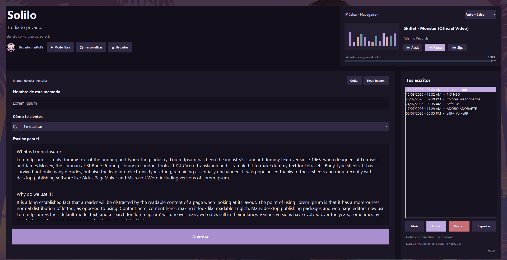
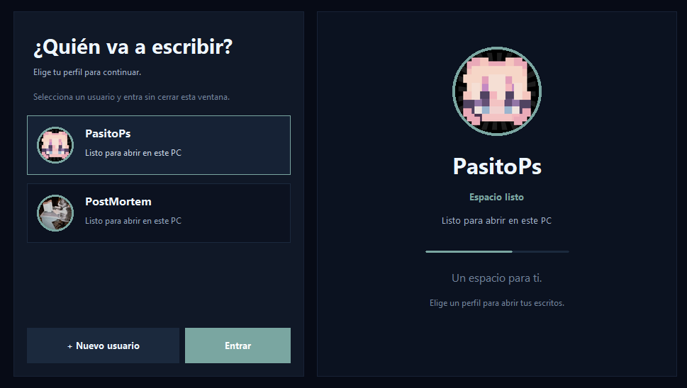
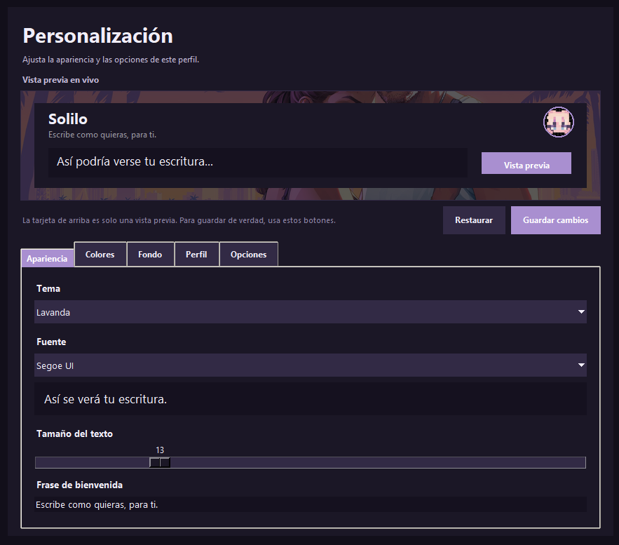
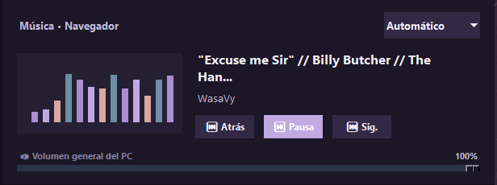

  

  <strong>by PasitoPs</strong>

  <em>Un espacio para ti.</em>

  Un lugar para escribir tus pensamientos, guardar tus recuerdos y expresar tus emociones.

  

---

## Bienvenido a Solilo

Solilo es un diario personal para Windows, creado para quienes disfrutan escribir y conservar sus momentos importantes.

Puedes plasmar tus ideas, contar cómo fue tu día o simplemente encontrar un espacio tranquilo para expresarte.

Tus escritos permanecen en tu computador, sin necesidad de crear cuentas ni utilizar servicios en la nube.

## ¿Qué puedes hacer en Solilo?

- **Escribir libremente:** guarda pensamientos, historias, recuerdos y emociones.
- **Crear perfiles personales:** organiza tus espacios de escritura.
- **Personalizar tu experiencia:** elige entre diferentes temas y opciones de apariencia.
- **Proteger tus recuerdos:** tus escritos se almacenan localmente con cifrado.
- **Conservar tu historia:** vuelve a tus escritos cuando quieras y continúa donde lo dejaste.
- **Recibir actualizaciones:** Solilo verifica la autenticidad de las actualizaciones antes de instalarlas.

## Descarga e instalación

Solilo está disponible para Windows en dos versiones:

| Versión | Descripción |
|---|---|
| **Instalador** | Recomendado. Instala Solilo y crea sus accesos directos. |
| **Portable** | Permite ejecutar Solilo sin realizar una instalación tradicional. |

### ¿Cómo empezar?

1. Entra en **[Descargar Solilo](https://github.com/PasitoPs/Pasito/releases/latest)**.
2. Descarga el instalador de la versión más reciente.
3. Ejecútalo y sigue las instrucciones.
4. Abre Solilo, crea tu perfil y empieza a escribir.

## Conoce Solilo

### 1. Tu espacio de escritura

Escribe, guarda, edita y organiza tus pensamientos y recuerdos. Personaliza los colores y las imagenes de fondo para crear un espacio a tu gusto.

  

### 2. Perfiles personales y protegidos

Crea perfiles independientes para organizar tus escritos. Puedes proteger cada perfil con una contraseña si lo deseas.

  

### 3. Personalizacion a tu manera

Explora diferentes temas, cambia colores y configura imagenes de fondo para adaptar Solilo a tu estilo.

  

### 4. Control de musica (BETA)

Consulta la cancion que estas escuchando, controla la reproduccion, cambia de pista y ajusta el volumen general del computador.

Esta funcion todavia esta en desarrollo y ofrece controles basicos.

  

## Privacidad

Solilo está pensado para que tus recuerdos sigan siendo tuyos.

No necesitas registrarte y la aplicación no incluye publicidad ni telemetría de uso. Tus escritos personales se guardan en tu equipo.

Puedes consultar más información en nuestra [Política de privacidad](PRIVACY.md).

---

## Información del proyecto

- [Historial de versiones](CHANGELOG.md)
- [Privacidad](PRIVACY.md)
- [Seguridad](SECURITY.md)
- [Distribución oficial](DISTRIBUTION.md)

  <strong>Solilo — by PasitoPs</strong>
   
  Hecho para quienes tienen algo que contar.

